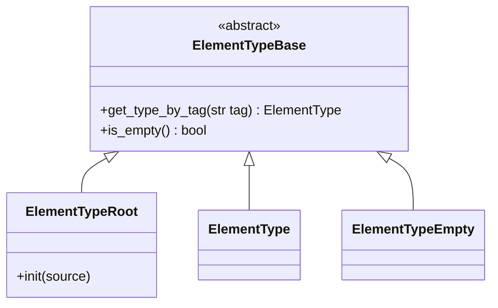

1. Основная масса года сделана с помощью LLM. Выбрал часть проекта, где хотелось бы лучшего понимания. В частности SOAP был просто написан агентом, работал и проходил тесты проекта. Добавляю в проект файлики вида `test_tdd.py` со своими тестами.
   
   В ходе написания тестов выяснил, что SOAP был реализован с нуля, было множество кода реализующее работу с XML. Перешел на использование пакета Spyne для создания SOAP сервисов. Потребление недельного лимита токенов как итог значительно снизилось. Пришлось незначительно снизить требования к поддерживаемым протоколам SOAP, что не критично.
   
   Создаваемый cервис подключается через переменную `SOAP_SERVICES` в настройки settings.py проекта на Django.

   Пример тестового кода.
```python
@override_settings(
    SOAP_SERVICES=("apps.soap.tests.test_tdd.echo_service",),
)
class SoapTest(SimpleTestCase):
    def test_wsdl(self):
        response = self.client.get("/ws/Example?wsdl")
        self.assertEqual(response.status_code, 200)
        self.assertIn(b"xml", response.content)

    def test_echo(self):
        request_xml = """
        <s:Envelope
            xmlns:s="http://schemas.xmlsoap.org/soap/envelope/"
            xmlns:m="urn:coremeetrics:example">
            <s:Body>
                <m:Echo>
                    <m:Value>Привет</m:Value>
                </m:Echo>
            </s:Body>
        </s:Envelope>
        """

        response = self.client.post(
            "/ws/Example",
            data=request_xml.encode("utf-8"),
            content_type="text/xml; charset=utf-8",
            HTTP_SOAPACTION='"urn:coremeetrics:example/Example/Echo"',
        )

        self.assertEqual(response.status_code, 200)
        self.assertIn("Привет!".encode("utf-8"), response.content)

    def test_zeep_echo(self):
        soap_client = TestSoapClient("Example", client=self.client)
        value = "Hello! Привет!!!"
        result = soap_client.service().Echo(Value=value)
        self.assertEqual(result, value + "!")

```

Класс TestSoapClient реализовал для повышения читабельности тестов, как обертку над SOAP клиентом zeep. 

2. Для того чтобы тесты и код следовали дизайну и логической архитектуре. Создал файлик, в котором стал описывать архитектуру. 
   Выбрал часть проекта где происходит преобразование XML-файла с данными в ORM-объекты для записи в базу данных.
   Первоначально предполагал использовать промежуточный объект `XML->Мой объект->ORM`, остановился на варианте со словарем `XML->Словарь->ORM`

На входе, XML который может содержать документ с вложенными повторными описаниями объектов:

```xml
<Документ.ДокументПоступление>
    <Ссылка>11111111-1111-4111-8111-111111111111</Ссылка>
    <Номер>ДОК-001</Номер>
    <Организация>
        <Ссылка>22222222-2222-4222-8222-222222222222</Ссылка>
        <Наименование>ООО «Организация 1»</Наименование>
    </Организация>
</Документ.ДокументПоступление>
<Документ.ДокументРеализация>
    <Ссылка>11111111-1111-5111-8111-111111111111</Ссылка>
    <Номер>ДОК-002</Номер>
    <Организация>
        <Ссылка>22222222-2222-4222-8222-222222222222</Ссылка>
        <Наименование>ООО «Организация 1»</Наименование>
    </Организация>
</Документ.ДокументРеализация>
```

На выходе хочу получить плоский cловарь, в котором ссылки на объекты:

```python
{
    (
        "Документ.ДокументПоступление",
        "11111111-1111-4111-8111-111111111111",
    ): {
        "Ссылка": "11111111-1111-4111-8111-111111111111",
        "Номер": "ДОК-001",
        "Организация": (
            "Справочник.Организации",
            "22222222-2222-4222-8222-222222222222",
        ),
    },
    (
        "Документ.ДокументРеализация",
        "11111111-1111-5111-8111-111111111111",
    ): {
        "Ссылка": "11111111-1111-4111-8111-111111111111",
        "Номер": "ДОК-002",
        "Организация": (
            "Справочник.Организации",
            "22222222-2222-4222-8222-222222222222",
        ),
    },
    (
        "Справочник.Организации",
        "22222222-2222-4222-8222-222222222222",
    ): {
        "Ссылка": "22222222-2222-4222-8222-222222222222",
        "Наименование": "ООО «Организация 1»",
    },
}
```


При загрузке из XML-файла важно знать тип объекта, к которому относятся данные. Можно по именам угадывать, можно информацию получать из `.xsd` файла. Первоначально планировал класс-обертку над XSD и даже одноименно назвать.

Но в итоге решил выбрать тип элемента за отправную точку. Как результат, код получения типа вложенного свойства объекта оказывается значительно компактнее.

```python
from src.xsd import ElementType, ElementTypeBase, ElementTypeRoot

root: ElementTypeBase = ElementTypeRoot(
    "doc/XSDschemeEntepriseData1_20.xsd"
)

document: ElementTypeBase = root.get_type_by_tag(
    "Документ.ПоступлениеТоваровУслуг"
)
assert not document.is_empty()
assert document.entity_type == "Объект"

keys: ElementTypeBase = document.get_type_by_tag("КлючевыеСвойства")
assert not keys.is_empty()
assert keys.entity_type == "КлючевыеСвойства"

organization: ElementTypeBase = keys.get_type_by_tag("Организация")
assert not organization.is_empty()
assert organization.entity_type == "КлючевыеСвойства"
assert organization.ref_type == "Справочник.Организации"

goods: ElementTypeBase = document.get_type_by_tag("Товары")
assert not goods.is_empty()
assert goods.entity_type == "ТабличнаяЧасть"

row: ElementTypeBase = goods.get_type_by_tag("Строка")
assert not row.is_empty()
assert row.entity_type == "СтрокаТабличнойЧасти"
assert row.many
```

И сделана иерархия классов, которая позволяет не использовать None и однотипно работать с элементами.




Общая рефлексия:

Если в первом случае больше исследовал кодовую базу. В результате чего нашел чуть более удачные объекты для работы, например, обернул SOAP клиент `zeep` в `TestSoapClient` и убрал из тестов часть кода, по смыслу относящиеся не к тестам, а настройкам SOAP клиента.

Во втором случае, когда следую за дизайном и логикой, есть элемент исследования предметной области. Согласуется с идеями из книги Бертрана Мейера "Основы объектно-ориентированного программирования с подходом "список покупок", и то, что с помощью ООП происходит исследование предметной области.

В настоящий момент это небольшой параллельный от основного проект. Основной делается с помощью агентов. Из вспомогательного планирую переносить небольшие компактные части в основной.

Следующий момент - это начать отходить от совсем плоского словаря. Так как в словаре есть логика данных. Данные могут быть представлены ссылкой, ключевыми свойствами и объектом. В минимальном варианте ссылка (тип + uuid). Но если обнаруживаем ключевые свойства, тогда уже используем эти данные за основные, а повторное помещение ссылки в словарь их уже не заменит.