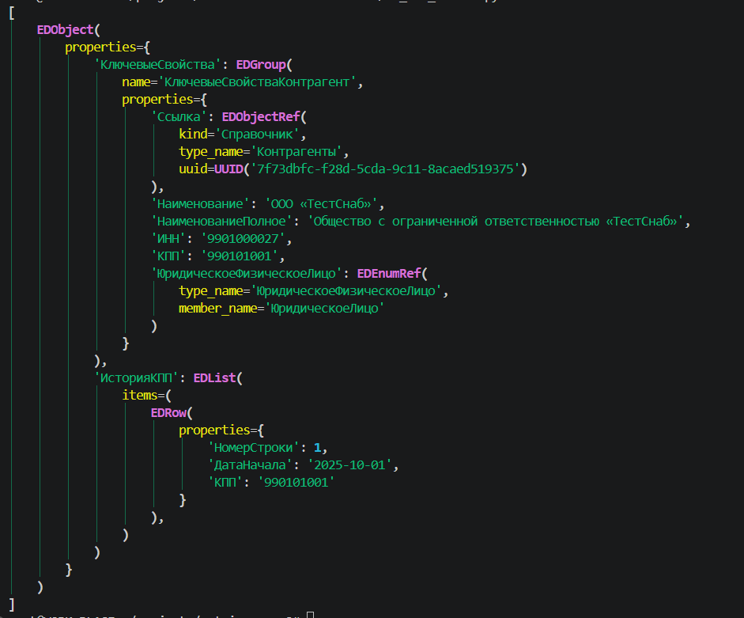
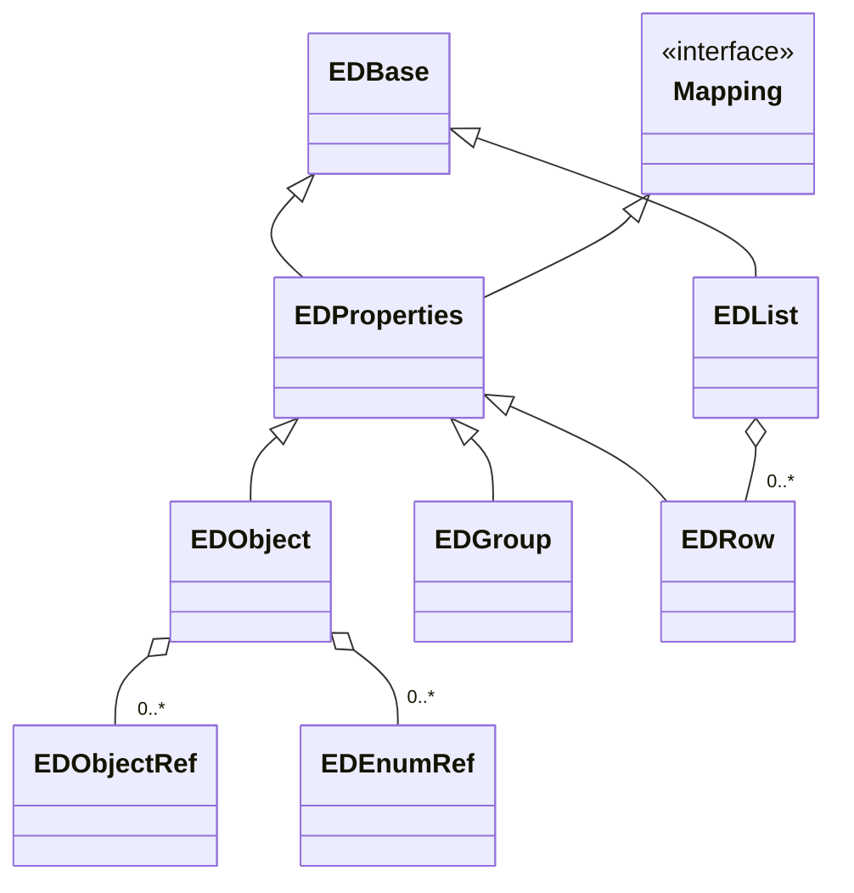

1. пример исходного кода
Без тестового блока суммарно объем кода около 329 строк не считая пусты строки.

<details>
<summary>Иходный код</summary>

```python
#xsd.py c описанимя типов
from __future__ import annotations

from abc import ABC, abstractmethod
from dataclasses import dataclass, field
from pathlib import Path
from typing import BinaryIO

from lxml import etree


NS = {"xs": "http://www.w3.org/2001/XMLSchema"}
OBJECT_BASE = "{http://www.1c.ru/SSL/Exchange/Message}Object"
REFERENCE_BASE = "{http://www.1c.ru/SSL/Exchange/Message}Ref"


class ElementTypeBase(ABC):
    """Общий интерфейс запросов к текущему контексту схемы."""

    @abstractmethod
    def get_type_by_tag(self, tag: str) -> ElementType:
        """Найти тип дочернего элемента по имени XML-тега.

        Локальное имя: "Организация".
        Полное имя в формате lxml: "{namespace}Организация".
        Для неописанного тега или чужого namespace возвращается ElementTypeEmpty.
        Запрос читает готовый индекс и не изменяет его.
        """

    @abstractmethod
    def is_empty(self) -> bool:
        """Проверить отсутствие описания типа в схеме, независимо от данных XML."""


@dataclass(frozen=True)
class ElementType(ElementTypeBase):
    """Неизменяемое описание XML-элемента для загрузчика EnterpriseData.

    Категории: Объект, КлючевыеСвойства, ТабличнаяЧасть,
    СтрокаТабличнойЧасти, Структура, Ссылка.
    Простые значения могут иметь XSD-тип, например xs:string или xs:decimal.
    Для отсутствующего описания ElementTypeEmpty использует категорию Пустой.
    """

    _root: ElementTypeRoot = field(repr=False, compare=False)  # Корневой контекст схемы.
    _type_name: str = field(repr=False)  # Имя XSD-типа для поиска его свойств.
    # Именованный тип: "КлючевыеСвойстваОрганизация".
    # Для анонимного типа создаётся служебное имя ИмяТипаРодителя/ИмяПоля.
    # Пример: "ОбщиеСвойстваДанныеНоменклатуры/Штрихкод".
    # Другой пример: "Документ.ПоступлениеТоваровУслуг.РасшифровкаДопРасходов.Строка/ДокументПоступления".
    entity_type: str  # Категория обработки или имя простого типа, например xs:decimal.
    is_complex: bool  # Описан через xs:complexType или является xs:anyType.
    many: bool = False  # Повторяемость поля по XSD: maxOccurs > 1 или unbounded.
    is_table: bool = False  # True для категории ТабличнаяЧасть.
    ref_type: str | None = None  # Тип объекта для (тип, UUID); None, если он не определён.

    def get_type_by_tag(self, tag: str) -> ElementType:
        """Вернуть описание дочернего поля по точному XSD-контексту типа."""
        return self._root._get_type_by_tag(tag, self._type_name)

    def is_empty(self) -> bool:
        """Описание типа найдено в схеме."""
        return False


@dataclass(frozen=True)
class ElementTypeEmpty(ElementTypeBase):
    """Пустое описание; поиск дочернего тега возвращает это же описание."""

    def get_type_by_tag(self, tag: str) -> ElementTypeEmpty:
        return self

    def is_empty(self) -> bool:
        return True


class ElementTypeRoot(ElementTypeBase):
    """Начальный контекст поиска объектов обмена EnterpriseData.

    Конструктор читает XSD и создаёт общий индекс с описаниями типов.
    Внешние схемы из xs:import не загружаются; валидация XML не выполняется.
    """

    def __init__(self, source: str | Path | BinaryIO) -> None:
        root = etree.parse(source).getroot()
        self.namespace: str = root.attrib["targetNamespace"]  # Пространство имён формата.
        # Тип XSD -> имя поля -> (тип значения, повторяемость).
        self._fields: dict[str, dict[str, tuple[str, bool]]] = {}
        # Простой тип -> базовые типы restriction или union.
        self._simple_types: dict[str, tuple[str, ...]] = {}
        self._objects: set[str] = set()
        # Тип ключевых свойств или простой ссылочный тип -> тип объекта обмена.
        self._references: dict[str, str] = {}

        for node in root.findall("xs:simpleType", NS):
            self._register_simple(node.attrib["name"], node)

        definitions = root.findall("xs:complexType", NS)
        for node in definitions:
            self._register(node.attrib["name"], node)

        # В схеме есть ключевые типы, для которых объект обмена не определён.
        key_types = {
            node.attrib["name"]
            for node in definitions
            if node.attrib["name"].startswith("КлючевыеСвойства")
        }
        for node in definitions:
            extension = node.find("xs:complexContent/xs:extension", NS)
            if extension is None:
                continue
            if self._type_name(extension, extension.attrib["base"]) != OBJECT_BASE:
                continue

            name = node.attrib["name"]
            self._objects.add(name)
            keys = self._fields[name].get("КлючевыеСвойства")
            if keys is not None:
                key_types.add(keys[0])
                self._references[keys[0]] = name

        # Через поле Ссылка связываем простой тип на базе Ref с объектом обмена.
        reference_types: dict[str, str] = {}
        for key_type, ref_type in self._references.items():
            reference = self._fields[key_type].get("Ссылка")
            if reference is not None and self._base_type(reference[0]) == REFERENCE_BASE:
                reference_types[reference[0]] = ref_type
        self._references.update(reference_types)

        # Соглашение формата: у таблицы единственное объявленное поле Строка.
        tables = {
            name for name, fields in self._fields.items()
            if set(fields) == {"Строка"}
        }
        rows = {self._fields[name]["Строка"][0] for name in tables}
        categories = {name: "Структура" for name in self._fields}
        categories["xs:anyType"] = "Структура"
        # Более конкретные роли переопределяют общую категорию Структура.
        categories.update({name: "СтрокаТабличнойЧасти" for name in rows})
        categories.update({name: "ТабличнаяЧасть" for name in tables})
        categories.update({name: "КлючевыеСвойства" for name in key_types})
        categories.update({name: "Объект" for name in self._objects})

        # Описания создаются в конструкторе, запросы только читают индекс.
        # Для объектов из корневого контекста many=False: повторяемость в Body
        # здесь не определяется. Для полей используется их объявление в XSD.
        element_types = {(name, False) for name in self._objects}
        for fields in self._fields.values():
            element_types.update(fields.values())

        self._types: dict[tuple[str, bool], ElementType] = {}
        for name, many in element_types:
            fields = self._fields.get(name)
            entity_type = categories.get(name)
            if entity_type is None:
                base_type = self._base_type(name)
                entity_type = "Ссылка" if base_type == REFERENCE_BASE else base_type
            self._types[name, many] = ElementType(
                _root=self,
                _type_name=name,
                entity_type=entity_type,
                is_complex=fields is not None or name == "xs:anyType",
                many=many,
                is_table=entity_type == "ТабличнаяЧасть",
                ref_type=(
                    name if name in self._objects else self._references.get(name)
                ),
            )

        self._empty = ElementTypeEmpty()

    def get_type_by_tag(self, tag: str) -> ElementType:
        """Вернуть описание самостоятельного объекта обмена из корня схемы.

        Допускаются локальные и полные XML-имена в формате {namespace}Имя.
        Для неописанного тега или чужого namespace возвращается ElementTypeEmpty.
        """
        return self._get_type_by_tag(tag)

    def is_empty(self) -> bool:
        """Корневой контекст существует даже при отсутствии объектов в схеме."""
        return False

    def _get_type_by_tag(
        self, tag: str, parent_name: str | None = None
    ) -> ElementType:
        qname = etree.QName(tag)
        if qname.namespace not in (None, self.namespace):
            return self._empty

        name = qname.localname
        if parent_name is None:
            if name not in self._objects:
                return self._empty
            key = name, False
        else:
            key = self._fields.get(parent_name, {}).get(name)
            if key is None:
                return self._empty

        return self._types[key]

    def _type_name(self, node: etree._Element, value: str) -> str:
        """Нормализовать QName типа с учётом namespace его объявления.

        Типы текущего формата получают локальное имя, типы XSD — xs:Имя,
        остальные типы — полное имя {namespace}Имя.
        """
        prefix, separator, name = value.partition(":")
        if separator:
            namespace = node.nsmap.get(prefix)
        else:
            name = value
            namespace = node.nsmap.get(None)

        if namespace == self.namespace:
            return name
        if namespace == NS["xs"]:
            return f"xs:{name}"
        return f"{{{namespace or ''}}}{name}"

    def _base_type(self, name: str, path: frozenset[str] = frozenset()) -> str:
        """Разрешить цепочку ограничений простого типа.

        Union сводится к базе, когда все участники разрешаются в одно имя.
        Иначе сохраняется имя объединения. Цикл определений вызывает ValueError.
        Неописанные в индексе базовые типы сохраняют своё имя.
        """
        bases = self._simple_types.get(name)
        if bases is None:
            return name
        if name in path:
            raise ValueError(f"Циклическое определение простого типа: {name}")

        resolved = {self._base_type(base, path | {name}) for base in bases}
        return next(iter(resolved)) if len(resolved) == 1 else name

    def _register_simple(self, name: str, node: etree._Element) -> None:
        """Записать базу restriction или участников union из memberTypes."""
        restriction = node.find("xs:restriction", NS)
        if restriction is not None and "base" in restriction.attrib:
            self._simple_types[name] = (
                self._type_name(restriction, restriction.attrib["base"]),
            )
            return

        union = node.find("xs:union", NS)
        if union is not None:
            bases = tuple(
                self._type_name(union, member)
                for member in union.get("memberTypes", "").split()
            )
            if bases:
                self._simple_types[name] = bases

    def _register(self, name: str, node: etree._Element) -> None:
        """Зарегистрировать поля сложного типа и его анонимные типы."""
        fields = self._fields[name] = {}
        for declaration in node.xpath(
            "*/xs:element | xs:complexContent/xs:extension/*/xs:element",
            namespaces=NS,
        ):
            field_name = declaration.attrib["name"]
            inline = declaration.find("xs:complexType", NS)
            simple = declaration.find("xs:simpleType", NS)

            if inline is not None or simple is not None:
                type_name = f"{name}/{field_name}"
                if inline is not None:
                    self._register(type_name, inline)
                else:
                    self._register_simple(type_name, simple)
            elif "type" in declaration.attrib:
                type_name = self._type_name(declaration, declaration.attrib["type"])
            else:
                type_name = "xs:anyType"

            many = declaration.get("maxOccurs", "1") not in {"0", "1"}
            fields[field_name] = type_name, many


if __name__ == "__main__":
    root: ElementTypeBase = ElementTypeRoot(
        Path(__file__).resolve().parents[1]
        / "doc"
        / "XSDschemeEntepriseData1_20.xsd"
    )

    assert isinstance(root, ElementTypeBase)
    assert not root.is_empty()

    document: ElementType = root.get_type_by_tag("Документ.ПоступлениеТоваровУслуг")
    assert not document.is_empty()
    assert isinstance(document, ElementTypeBase)
    assert document.is_complex
    assert document.entity_type == "Объект"
    assert document.ref_type == "Документ.ПоступлениеТоваровУслуг"

    keys: ElementType = document.get_type_by_tag("КлючевыеСвойства")
    assert not keys.is_empty()
    assert keys.is_complex
    assert keys.entity_type == "КлючевыеСвойства"
    assert keys.ref_type == "Документ.ПоступлениеТоваровУслуг"

    organization: ElementType = keys.get_type_by_tag("Организация")
    assert not organization.is_empty()
    assert organization.is_complex
    assert organization.entity_type == "КлючевыеСвойства"
    assert organization.ref_type == "Справочник.Организации"

    organization_reference: ElementType = organization.get_type_by_tag("Ссылка")
    assert not organization_reference.is_empty()
    assert organization_reference.entity_type == "Ссылка"
    assert organization_reference.ref_type == "Справочник.Организации"
    assert not organization_reference.is_complex

    document_reference: ElementType = keys.get_type_by_tag("Ссылка")
    assert not document_reference.is_empty()
    assert document_reference.entity_type == "Ссылка"
    assert document_reference.ref_type == "Документ.ПоступлениеТоваровУслуг"
    assert not document_reference.is_complex

    date: ElementType = keys.get_type_by_tag("Дата")
    assert not date.is_empty()
    assert not date.is_complex
    assert date.entity_type == "xs:dateTime"
    assert date.ref_type is None

    goods: ElementType = document.get_type_by_tag("Товары")
    assert not goods.is_empty()
    assert goods.entity_type == "ТабличнаяЧасть"
    assert goods.ref_type is None
    assert goods.is_table
    assert not goods.many

    goods_row: ElementType = goods.get_type_by_tag("Строка")
    assert not goods_row.is_empty()
    assert goods_row.entity_type == "СтрокаТабличнойЧасти"
    assert goods_row.many

    product_data: ElementType = goods_row.get_type_by_tag("ДанныеНоменклатуры")
    assert not product_data.is_empty()
    assert product_data.entity_type == "Структура"
    assert product_data.ref_type is None
    assert product_data.is_complex

    barcode: ElementType = product_data.get_type_by_tag("Штрихкод")
    assert not barcode.is_empty()
    assert barcode.entity_type == "xs:string"
    assert not barcode.is_complex

    product: ElementType = product_data.get_type_by_tag("Номенклатура")
    assert not product.is_empty()
    assert product.entity_type == "КлючевыеСвойства"
    assert product.ref_type == "Справочник.Номенклатура"

    amount: ElementType = goods_row.get_type_by_tag("Сумма")
    assert not amount.is_empty()
    assert not amount.is_complex
    assert amount.entity_type == "xs:decimal"
    assert amount.ref_type is None

    quantity: ElementType = goods_row.get_type_by_tag("Количество")
    assert not quantity.is_empty()
    assert quantity.entity_type == "xs:decimal"
    assert not quantity.is_complex

    line_number: ElementType = goods_row.get_type_by_tag("НомерСтрокиДокумента")
    assert not line_number.is_empty()
    assert line_number.entity_type == "xs:int"
    assert not line_number.is_complex

    operation: ElementType = document.get_type_by_tag("ВидОперации")
    assert not operation.is_empty()
    assert operation.entity_type == "xs:string"
    assert not operation.is_complex

    services: ElementType = document.get_type_by_tag("Услуги")
    assert not services.is_empty()
    assert services.entity_type == "ТабличнаяЧасть"
    assert services.ref_type is None
    assert services.is_table
    assert services is not goods

    services_row: ElementType = services.get_type_by_tag("Строка")
    assert not services_row.is_empty()
    assert services_row.entity_type == "СтрокаТабличнойЧасти"
    assert services_row.many
    assert services_row is not goods_row

    catalog: ElementType = root.get_type_by_tag("Справочник.Номенклатура")
    assert not catalog.is_empty()
    assert catalog.entity_type == "Объект"

    alcohol_data: ElementType = catalog.get_type_by_tag("ДанныеАлкогольнойПродукции")
    assert not alcohol_data.is_empty()
    assert alcohol_data.entity_type == "Структура"

    alcohol_kind: ElementType = alcohol_data.get_type_by_tag("ВидАлкогольнойПродукции")
    assert not alcohol_kind.is_empty()
    assert alcohol_kind.entity_type == "КлючевыеСвойства"
    assert alcohol_kind.ref_type is None

    qualified_document: ElementType = root.get_type_by_tag(
        "{http://v8.1c.ru/edi/edi_stnd/EnterpriseData/1.20}"
        "Документ.ПоступлениеТоваровУслуг"
    )
    assert qualified_document is document

    unknown_object: ElementType = root.get_type_by_tag("НетТакогоОбъекта")
    assert unknown_object.is_empty()
    assert isinstance(unknown_object, ElementTypeEmpty)
    assert unknown_object.entity_type == "Пустой"
    assert not unknown_object.is_complex
    assert not unknown_object.many
    assert not unknown_object.is_table
    assert unknown_object.ref_type is None

    unknown_field: ElementType = keys.get_type_by_tag("НетТакогоПоля")
    assert unknown_field.is_empty()
    assert unknown_field is unknown_object

    organization_without_parent: ElementType = root.get_type_by_tag("Организация")
    assert organization_without_parent.is_empty()

    foreign_organization: ElementType = keys.get_type_by_tag("{urn:other}Организация")
    assert foreign_organization.is_empty()

    scalar_child: ElementType = date.get_type_by_tag("Организация")
    assert scalar_child.is_empty()

    missing_child: ElementType = unknown_object.get_type_by_tag(
        "Документ.ПоступлениеТоваровУслуг"
    )
    assert missing_child.is_empty()
    assert missing_child is unknown_object

    print("Все проверки XSD пройдены.")
```


```python
#xml_reader.py загрузка файла в заданную выше систему типов
"""Преобразование XML EnterpriseData в словарь объектов по описаниям XSD."""

from pathlib import Path
from typing import BinaryIO, cast

from lxml import etree

from src.xsd import ElementType, ElementTypeBase, ElementTypeRoot


type ObjectKey = tuple[str, str]
type Value = str | ObjectKey | list[Value] | dict[str, Value]
type Properties = dict[str, Value]
type Objects = dict[ObjectKey, Properties]


def load_objects(source: str | Path | BinaryIO, schema: ElementTypeRoot) -> Objects:
    """Вернуть новый плоский словарь объектов, не изменяя переданную схему.

    Поддерживаются Message с Body, отдельный Body и отдельный объект.
    Собственные КлючевыеСвойства раскрываются в поля объекта; вложенные
    сущности заменяются парами (тип, UUID). Табличные части становятся списками,
    остальные структуры остаются словарями. Простые значения остаются строками.
    Повторные описания объединяются по полям; последнее значение поля побеждает.
    Неизвестный элемент или отсутствие Ссылка у сущности вызывает ValueError.
    В первой реализации XML целиком читается в память; валидация XSD не выполняется.
    """
    parser = etree.XMLParser(
        remove_comments=True, remove_pis=True, resolve_entities=False, no_network=True
    )
    root = etree.parse(source, parser).getroot()
    body_tags = {"Body", f"{{{schema.namespace}}}Body"}

    if root.tag in body_tags:
        body = root
    elif etree.QName(root).localname == "Message":
        bodies = [child for child in root if child.tag in body_tags]
        if len(bodies) != 1:
            raise ValueError("Message должен содержать ровно один элемент Body")
        body = bodies[0]
    else:
        _, objects = _read_value(root, _element_type(root, schema))
        return objects

    objects: Objects = {}
    for element in body:
        _, nested_objects = _read_value(element, _element_type(element, schema))
        _merge_objects(objects, nested_objects)
    return objects


def _element_type(element: etree._Element, context: ElementTypeBase) -> ElementType:
    """Запросить тип элемента в контексте родителя; неизвестные теги запрещены."""
    element_type = context.get_type_by_tag(element.tag)
    if element_type.is_empty():
        path = element.getroottree().getpath(element)
        raise ValueError(f"Неизвестный элемент {element.tag!r} в XSD: {path}")
    return element_type


def _read_value(element: etree._Element, element_type: ElementType) -> tuple[Value, Objects]:
    """Вернуть значение и выделенные из него объекты без внешнего накопителя."""
    if not element_type.is_complex:
        if len(element):
            raise ValueError(f"Простое поле {element.tag!r} содержит вложенные элементы")
        text = element.text or ""
        if (
            element_type.entity_type == "Ссылка"
            and element_type.ref_type
            and etree.QName(element).localname != "Ссылка"
        ):
            properties: Properties = {"Ссылка": text}
            key = _object_key(element_type.ref_type, properties)
            return key, {key: properties}
        return text, {}

    properties, objects = _read_properties(element, element_type)
    if element_type.is_table:
        rows = properties.get("Строка", [])
        return (rows if isinstance(rows, list) else [rows]), objects
    if element_type.ref_type:
        key = _object_key(element_type.ref_type, properties)
        _merge_objects(objects, {key: properties})
        return key, objects
    return properties, objects


def _read_properties(
    element: etree._Element, element_type: ElementType
) -> tuple[Properties, Objects]:
    """Вернуть поля структуры и объекты, найденные в её дочерних элементах."""
    properties: Properties = {}
    objects: Objects = {}
    for child in element:
        field_type = _element_type(child, element_type)
        name = etree.QName(child).localname
        if name == "КлючевыеСвойства" and element_type.entity_type == "Объект":
            key_properties, nested_objects = _read_properties(child, field_type)
            properties.update(key_properties)
        else:
            value, nested_objects = _read_value(child, field_type)
            if field_type.many:
                cast(list[Value], properties.setdefault(name, [])).append(value)
            else:
                properties[name] = value
        _merge_objects(objects, nested_objects)
    return properties, objects


def _object_key(ref_type: str, properties: Properties) -> ObjectKey:
    """Получить ключ объекта из его собственных полей."""
    uid = properties.get("Ссылка", "")
    if not isinstance(uid, str) or not uid.strip():
        raise ValueError(f"У объекта {ref_type!r} отсутствует непустое поле Ссылка с UUID")
    return ref_type, uid


def _merge_objects(target: Objects, source: Objects) -> None:
    """Команда: дополнить накопитель; последнее значение поля заменяет предыдущее."""
    for key, properties in source.items():
        target.setdefault(key, {}).update(properties)

```

</details>


2. Проектирование дизайна кода

Необходимо при загрузке XML файла определять тип загружаемых узлов. Тип узла определен в файле XSD. И на основании этого уже создавать объекты.

XSD схема соответствует формату `EnterpriseData_1.20`, возможно повышения до `1_25`

Тип создаваемого объекта в ORM определяется xsd-тэгом и атрибутом name. Что-бы не быть привязанным в DajngoORM, буду выгружать данные в промежуточный формат.

Пример тэга:
```xml
<xs:complexType name="Документ.ПоступлениеТоваровУслуг">
```

При этом будут и тэги их которых, объекты не создаются, а они нужны для получения корректного значения.

```xml
	<xs:simpleType name="ТипИдентификаторСтроки">
		<xs:restriction base="xs:string">
			<xs:maxLength value="36"/>
		</xs:restriction>
	</xs:simpleType>
```

В файле XSD описывается около 180 типов. 

Объекты создаются из некоторых `xs:complexType`

В файле активно используется кириллица при определении свойства name.
Поэтому определю универсальный объект
```python
EDObject:	
	name_properties() -> [str]
	get_property(name:str) -> str | int | Decimal | EDObject | [EDObject]
```

Объект будет иммутабельным, значения полей будут задаваться в конструкторе.
Рассматриваю иерархию от EDBase, вида `EDBase <- EDObject` и `EDBase <- EDList`. Но тогда если продолжать в декларативном стиле описывать объект должны быть и типы `EDInt`, `EDStr`, `EDDecimal`.
Поскольку задание предполагает максимально декларативный стиль, то итоговая иерархия объектов будет.

```python
EDBase:
	...
	
EDStr(EDBase):
	...
	
EDInt(EDBase):
	...
	
EDDecimal(EDBase):
	...
	
EDObject(EDBase):
	properties() -> (str, EDBase) #имя свойства и значение
	
EDList(EDBase):
	list() -> [EDBase] #постусловие: все значения одного подтипа

```

Общие методы определю позже. Когда стану исследовать возможность создания ORM объектов, и классам клиентам потребуются методы.

Для разбора XML и сразу определения типа элемента буду использовать

```python
import xmlschema

class ED_1_20_Converter(xmlschema.XMLSchemaConverter):
    def element_decode(
        self, data, xsd_element, xsd_type=None, level=0
    ):
	    
	    #Здесь код создания объектов EDBase. в зависимости от xsd_element и xsd_type
	    ...


        # Остальные значения обрабатыват стандартно
        base_value =  super().element_decode(
            data, xsd_element, xsd_type, level
        )
        
        return ... #здесь код вида EDStr(base_value), для создания простых объектов
        
schema = xmlschema.XMLSchema("schema.xsd")
ed_data = schema.decode("data.xml", converter=ED_1_20_Converter)

```

В общих чертах архитектура описана.

Есть еще момент с уникальностью объектов. Некоторые объекты вида EDObject однозначно определяются именем типа и uuid. А значит, надо определить статический метод класса, который по имени типа и uuid будет создавать новый элемент или обновлять существующий. Следуя принципу ISP, это поведение должно касаться только EDObject, а значит, EDObject и переопределю, не трогая EDBase.


```python
EDObject(EDBase):
	properties() -> (str, EDBase) #имя свойства и значение
	uuid() -> uuid | None #некоторые составные объекты не имеют ссылок
	type() -> str
	
	def _update(properties: dict[str, EDBase]):
		...
		
	@statticmethod	
	def _find(type: str, uuid: uuid) -> EDObject:
		...
	
	@classmethod 
	def new_unic(cls, type: str, uuid: uuid, properties):
		... #ищет в словаре класса (type, uuid) если находит одновляет значения 
		obj = cls._find(type, uuid)
		if obj:
			obj._update(properties)
			return obj
			
		return EDObject(properties)		
		
	
```

Следующий момент — это отображение типов XSD в типы EDBase, которые должны быть приближены по виду к таблицам базы данных. В XSD-типах EnterpriseData есть для документа "ПоступлениеТоваровУслуг" типа "Документ.ПоступлениеТоваровУслуг", "КлючевыеСвойстваПоступлениеТоваровУслуг", "ДокументСсылка.ПоступлениеТоваровУслуг". И так для каждого документа.

В минимальном виде может выгрузиться только ссылка, тоесть тип "ПоступлениеТоваровУслуг", и это будет "ДокументСсылка". При загрузке данных такие вещи желательно отслеживать, когда для объекта не обнаружатся в таблице данные, то их можно будет догрузить отдельной выгрузкой из 1C.

Для объекта введу литеральный тип:`EDObjectLevel = "Ref" | "Key" | "Obj"`. Операцию сравнения для этого типа. Будет соответствующая колонка в таблице с этими значениями, и она будет обновляться, если поменялись записи или повысился "уровень объекта", например, с "Ref" на "Key", и три колонки с датами, которые будут говорить, когда это произошло.Но это уже относится больше к работе с ORM-моделью.

```
EDObject(EDBase):
	...
	level() -> "Ref" | "Key" | "Obj"
	...
```

Можно переходить к реализации.


3. Пример нового кода
Без тестового блока суммарно объем кода около 160 строк, не считая пустые строки.  
Меньше примерно в два раза. Если считать пустые строки, то пропорция сохраняется. 

```python
#Описание загружаемых типов
from collections.abc import Iterator, Mapping
from enum import IntEnum
from typing import Literal
from uuid import UUID
from dataclasses import dataclass
from collections.abc import Iterable


@dataclass(frozen=True)
class EDObjectRef:
    kind: Literal["Документ", "Справочник"]
    type_name: str
    uuid: UUID


@dataclass(frozen=True)
class EDEnumRef:
    type_name: str
    member_name: str


class EDBase:
    def __repr__(self) -> str:
        fields = ", ".join(
            f"{name.removeprefix('_')}={value!r}"
            for name, value in self.__dict__.items()
        )
        return f"{type(self).__name__}({fields})"

    def __rich_repr__(self):
        for name, value in self.__dict__.items():
            yield name.removeprefix("_"), value


class EDProperties(EDBase, Mapping[str, object]):
    def __init__(self, properties):
        self._properties = properties

    def __getitem__(self, key: str) -> object:
        return self._properties[key]

    def __iter__(self) -> Iterator[str]:
        return iter(self._properties)

    def __len__(self) -> int:
        return len(self._properties)


class EDObject(EDProperties):
    _ed_objects = {}

    def __new__(cls, properties):
        if not properties:
            raise ValueError("Не указаны свойства")

        ref = properties["КлючевыеСвойства"]["Ссылка"]
        ed_object = cls._ed_objects.get(ref)

        if ed_object:
            ed_object._properties |= properties
            return ed_object

        ed_object = super().__new__(cls)

        cls._ed_objects[ref] = ed_object

        return ed_object


class EDGroup(EDProperties):
    def __init__(self, name: str, properties):
        self._name = name
        super().__init__(properties)

    def name(self) -> str:
        return self._name


class EDRow(EDProperties):
    pass


class EDList(EDBase):
    def __init__(self, items: Iterable[EDRow]) -> None:
        self._items = tuple(items)

    def items(self) -> tuple[EDRow, ...]:
        return self._items
```

```python
#Парсер XML файла в заднную выше систему типов
from pathlib import Path
from uuid import UUID
from xml.etree import ElementTree as ET

import xmlschema

from ed_objects import EDGroup, EDList, EDObject, EDRow, EDEnumRef, EDObjectRef
from pretty_print import print_data


class EDXMLReader:
    def __init__(self, ed_xsd_path: Path, message_xsd_path: Path) -> None:
        ed_xsd_path = ed_xsd_path.resolve()
        message_xsd_path = message_xsd_path.resolve()
        self._schema = xmlschema.XMLSchema11([ed_xsd_path, message_xsd_path])
        self._ed_namespace = self._schema.target_namespace
        self._message_namespace = (
            ET.parse(message_xsd_path).getroot().get("targetNamespace", "")
        )

    def read(self, xml_root: ET.Element) -> list[EDObject]:
        body = xml_root.find(f"{{{self._ed_namespace}}}Body")
        if body is None:
            raise ValueError("В XML отсутствует элемент Body формата EnterpriseData")

        objects = []
        for element in body:
            xsd_type = self._schema.maps.types.get(element.tag)
            if xsd_type is None:
                raise NotImplementedError(
                    f"Неизвестный XSD-тип для XML-элемента {element.tag!r}"
                )

            ed_object = xsd_type.decode(
                element,
                converter=self._Converter,
                ed_namespace=self._ed_namespace,
                message_namespace=self._message_namespace,
                strip_namespaces=True,
            )

            objects.append(ed_object)

        return objects

    class _Converter(xmlschema.XMLSchemaConverter):
        XS_NAMESPACE = "http://www.w3.org/2001/XMLSchema"

        def __init__(self, ed_namespace: str, message_namespace: str, **kwargs) -> None:
            super().__init__(**kwargs)
            self._ed_namespace = ed_namespace
            self._message_namespace = message_namespace

        def element_decode(self, data, xsd_element, xsd_type=None, level=0):
            xsd_type = xsd_type or xsd_element.type
            value = super().element_decode(data, xsd_element, xsd_type, level)

            local_name = xsd_type.local_name or ""
            type_info = [
                xsd_type.target_namespace,
                xsd_type.is_atomic(),
                *local_name.split("."),
            ]

            match type_info:
                case ["" | self.XS_NAMESPACE | self._message_namespace, *_]:
                    return value

                case [self._ed_namespace, _, "ДокументСсылка", type_object]:
                    return EDObjectRef("Документ", type_object, UUID(value))

                case [self._ed_namespace, _, "СправочникСсылка", type_object]:
                    return EDObjectRef("Справочник", type_object, UUID(value))

                case [self._ed_namespace, _, "Документ" | "Справочник", _]:
                    return EDObject(value)

                case [self._ed_namespace, True, *_]:
                    return (
                        EDEnumRef(local_name, value) if xsd_type.enumeration else value
                    )

                case [self._ed_namespace, False, *_, "Строка"]:
                    return EDRow(value)

                case [self._ed_namespace, False, name_group]:
                    return EDGroup(name_group, value)

                case [self._ed_namespace, False, _, _, _]:
                    return EDList(value["Строка"])

                case _:
                    raise NotImplementedError(
                        f"Необработанный XML-элемент {data.tag!r}: "
                        f"XSD-тип {xsd_type.name!r}, признаки {type_info!r}"
                    )


if __name__ == "__main__":
    folder = Path(__file__).resolve().parent
    reader = EDXMLReader(
        ed_xsd_path=folder / "XSDschemeEntepriseData1_20.xsd",
        message_xsd_path=folder / "ExchangeMessage.xsd",
    )
    xml_root = ET.parse(
        folder / "test_data" / "enterprise_data_catalog_with_table_test.xml"
    ).getroot()
    ed_data = reader.read(xml_root)
    print_data(ed_data, max_lines=150)

```

Вид загружаемых объектов:


4. Пострефлексия.
   
   По факту система типов получилась проще изначальной. Не стал оборачивать примитивные типы. Плюс получилось сокращение значительно из-за использования языковых конструкций сопоставления с образцом 




Система типов, с одной стороны, удобна для загрузки в базу данных, хорошо соотносится с предметной областью документооборота 1С и с системой типов формата обмена данными EnterpriseData.

Решил отказаться от уровней объектов "Ссылка", "Ключевые свойства" и «Объект». А есть ссылки для объектов и ссылки для перечислений. С помощью ссылки можно однозначно идентифицировать объект.

Код отправил в проект, был принят LLM практически без изменений. Согласился, что использовать словарь как экземпляр класса небезопасно, и был добавлен объект, отвечающий за контекст загрузки. Плюс согласился, что лучше проверить, если у объекта, найденного по ссылке, поля отличаются, то есть в разных частях файла для одного объекта они различны. Что привело к небольшому усложнению кода.


----


Следующий пример кода ищу с помощью оценки цикломатической сложности. Найден класс в 600 строк. Дальнейшая работа с кодом будет с помощью LLM.

Класс отвечает за сохранение объектов в базу данных. Причина - непонимание идеи  `чтение XML с XSD → EDBase → ORM-объекты → сохранение` , в записях базы данных были данные XSD. Плюс учет граничных случаев, на который лучше кидать исключение.

При рефакторинге был предложен метод identity() для объектов EDBase и dataclass-тип EDIdentity. В дальнейшем его можно будет упростить, равно как и метод identity(), количество полей избыточно, возможно как следствие отсутствия нужных формулировок спецификации. Сейчас в процессе получения от LLM следующей итерации изменений кода.

С одной стороны изначальная работа над парсингом XML был трудоемкой и длительной, с другой стороны значительно повысила уровень контроля над кодом проекта. Были использованы новые конструкции сопоставления с образцом. Найдено удобное использование пакета `xmlschema`. Код мог быть ещё компактнее, если бы 'xmlschema' не кидала исключения на нетипизрованные XML-тэги.