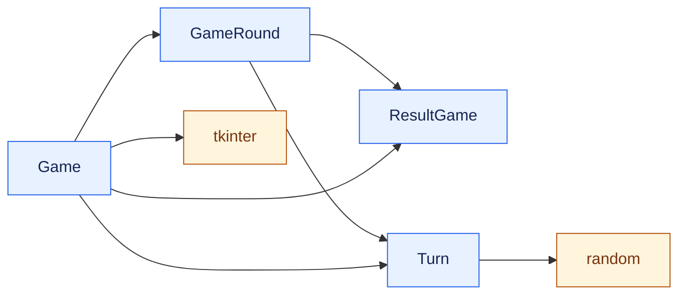
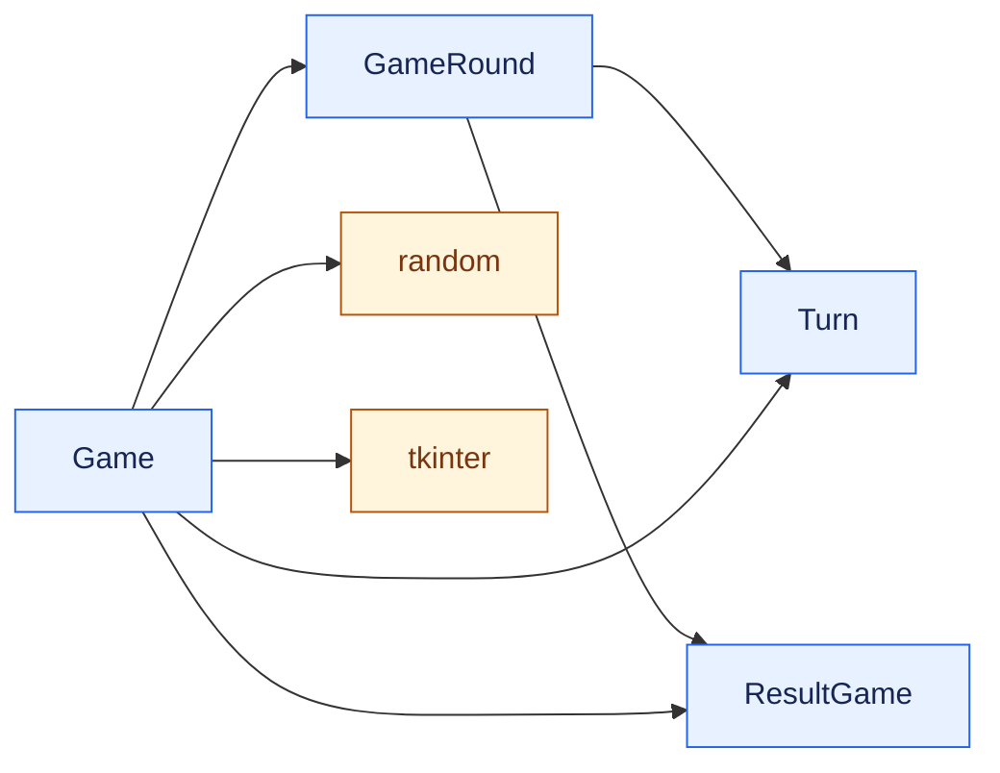

**Существуют ли ситуации, когда связи между модулями должны делаться публичными?**

Есть идея модулей и есть идея ООП. Идея модулей строится вокруг набора функций. Буду считать cвязь между модулями импорт функций из одного модуля в другой.
При повторного использования модуля в другом проекте, может быть необходима информация, какие еще зависимости перенести. А значит в этом случае публичная связь между модулями нужна публичная.

Другое направление связи, о том где используется модуль, необходимо знать, если хотим иметь возможность менять используемый интерфейс модуля, что бы понять на что повлияет.

**Какие метрики вы бы предложили для количественной оценки принципов организации модулей?**

Количество связей между модулями не подойдет, так как количество модулей может определяться предметной областью. При этом за единицу считаю сам факт наличия таких связей, буду называть связность. А вот количество связностей между модулями, деленное на число модулей, лучше отражает качество архитектуры. 

А например за двустороннюю связь между модулями вводить штраф.

**Если вы разрабатывали программы, в которых было хотя бы 3-5 классов, как бы вы оценили их модульность по этим метрикам?**

Возьму за основу [task1_2_after.py](../HardWork/task1_2_after.py).
Классы ResultGame, Turn, GameRound, Game и внешние модули tkinter и random.
Модуль tkinter предоставляет классы для работы с формой. Внешние модули буду отображать одним квадратом, не отображая поставляемые классы.

Посчитаю связь между "своими классами". Связей 5, классов 4. Коэффициент 4/5 = 1.25. Внешние модули не учитываю.

С внешними модулями хотелось бы уменьшить взаимодействие. В идеале только дин класс взаимодействует. Для этого использовал бы метрику доля классов взаимодействующих с внешними  модулями. Сейчас это 2/4=0.5

Теперь это 1/4 = 0.25

Enum - не считаю внешним модулем хоть и импортирую, считаю это частью реализации базовой возможности языка Python.
